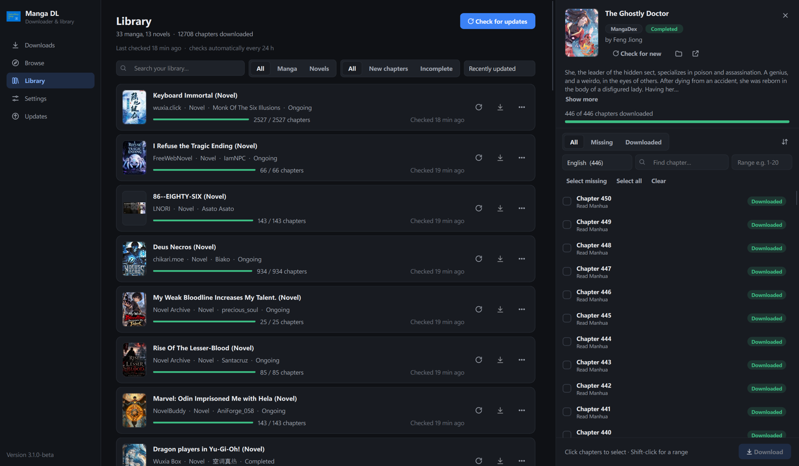
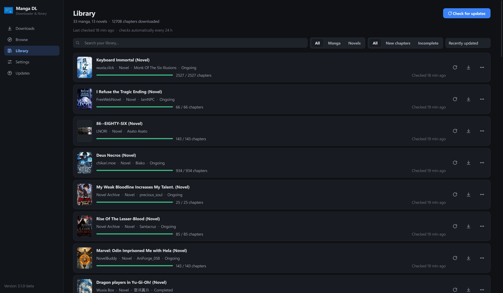
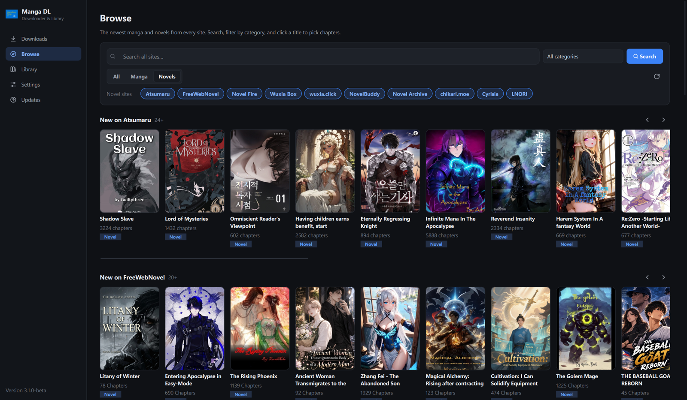
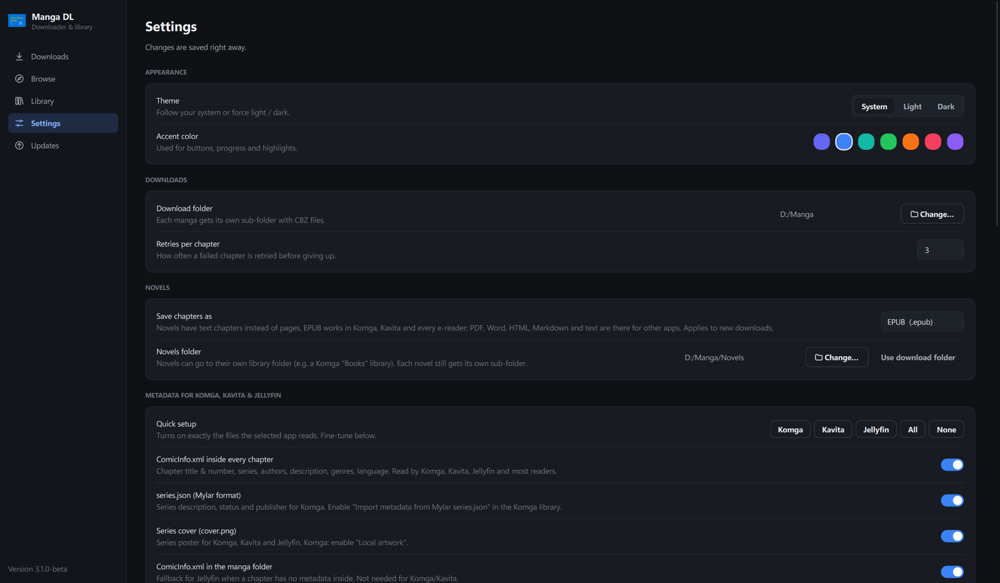

<div align="center">


# Manga DL

Download manga, manhwa and web novels from a bunch of sites and keep them in one library.
Works great next to Komga, Kavita or Jellyfin.

[Download](https://github.com/MasterOfKay/MasterOfKays-Manga-DL/releases/latest) ·
[Report a bug](https://github.com/MasterOfKay/MasterOfKays-Manga-DL/issues) ·
[MIT License](LICENSE.md)

</div>



## What it does

You paste a link (or find something on the Browse page), tick the chapters you want and hit download.
Manga ends up as CBZ files, novels as EPUB, one folder per series. After that the app keeps an eye
on your library and tells you when new chapters are out. If you want, it downloads them on its own.

Things I use it for every day:

- **Queue that you can walk away from.** Pause, resume, retry the failed ones.
- **Library with update checks.** It checks every hour by default (you can change that) and shows a badge
  when something new came out. The Incomplete filter shows what you still haven't grabbed.
- **Browse.** The latest updates from every site on one page, with search and categories.
- **Novels too.** Text chapters get saved as EPUB by default. PDF, Word, HTML, Markdown and plain
  text work as well. Novels can go into their own folder, e.g. a separate Komga "Books" library.
- **Media server metadata.** ComicInfo.xml inside each chapter, Mylar `series.json` and a cover
  image, so Komga, Kavita and Jellyfin show proper titles, descriptions and posters. There's a
  one-click setup for each of them in the settings.
- **MangaDex languages and groups.** Pick one language or several, and choose which scanlation
  group you want a chapter from if more than one uploaded it.
- **Updates itself** from the GitHub releases (betas are opt-in).

## Supported sites

| Manga / Manhwa | Web novels |
| --- | --- |
| [Asura Comics](https://asurascans.com) | [FreeWebNovel](https://freewebnovel.com) |
| [MangaKatana](https://mangakatana.com) | [Novel Fire](https://novelfire.net) |
| [Webtoon](https://www.webtoons.com) | Wuxia Box |
| [MangaDex](https://mangadex.org) | wuxia.click |
| MangaFreak | NovelBuddy |
| Atsumaru | Novel Archive |
| MangaBall | chikari.moe |
| Weeb Central | [Cyrisia](https://cyrisia.com) (novels, light novels and comics) |
| | LNORI |

Sites change their layout from time to time and that breaks things. If one stops working, please
open an issue with the link you tried.

## Screenshots

<table>
  <tr>
    <td></td>
    <td></td>
  </tr>
  <tr>
    <td align="center">Library</td>
    <td align="center">Browse</td>
  </tr>
  <tr>
    <td></td>
    <td></td>
  </tr>
  <tr>
    <td align="center">Settings</td>
    <td align="center">Picking chapters</td>
  </tr>
</table>

## Getting it

### Ready-made build

Grab `MangaDL-windows.exe` or `MangaDL-linux` from the
[latest release](https://github.com/MasterOfKay/MasterOfKays-Manga-DL/releases/latest) and run it.
No Python needed.

### From source

You need Python 3.10 or newer.

```bash
git clone https://github.com/MasterOfKay/MasterOfKays-Manga-DL.git
cd MasterOfKays-Manga-DL
pip install -r requirements.txt
python main.py
```

## Where your stuff goes

Downloads land in the folder you set in Settings (you can change it any time):

```
Manga/
├── Solo Leveling/
│   ├── cover.png
│   ├── series.json
│   ├── Chapter 1 - The Weakest Hunter.cbz
│   └── Chapter 2.cbz
└── Shadow Slave (Novel)/
    ├── Chapter 1.epub
    └── Chapter 2.epub
```

The app's own data (library database, settings, covers, logs) lives in `~/.mangadownloader`,
which is `C:\Users\<you>\.mangadownloader` on Windows.

## A note from me

The download code is pretty much all mine. For the UI I had a lot of help from AI, and some of the
English text too, because English isn't my first language. So if something reads weird, that's why.

## Please support the creators

This is meant for keeping your own offline copies. If a series has an official release, buy it or
read it on the official app. The people making these stories deserve it.

## Contributing

Bug reports, site requests and pull requests are all welcome. For a broken site, the link you used
and the error from the app help a lot. Turning on *Debug log* under Settings › Advanced writes
`manga_downloader.log` into the data folder, and attaching that is even better.

Licensed under [MIT](LICENSE.md).
